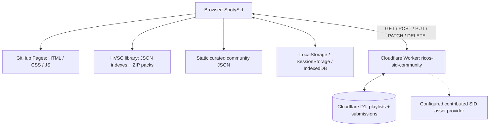

# SpotySid — Architecture and operational map

Updated: 2026-11-10. This is the **current** map; the former TEST62 architecture report remains a historical snapshot.

## Components



### Frontend / audio

- `index.html` loads `css/style.css`, `js/customPlaylist.test101.js`, `js/sidPlayer.js`, `js/backend_tinysid.js`, JSZip, HELP and DONATE.
- The `test101` filename is historical; it is currently loaded by `index.html`. Do not rename or replace without checking all references.
- The SID engine is separate from the community and playlist code. Avoid changing playback when working on catalog or UI.
- `library/index.json`, `library/data/` and `library/packs/` supply HVSC metadata and ZIP files. The documented HVSC #85 index contains 59,626 SID (56,568 MUSICIANS and 3,058 DEMOS).
- `community/playlists.json` and `community/playlists/` contain curated static lists. Public user playlists are separate D1 records.
- Progressive first-track loading is used for selected large playlists, including RICO'S BEST OF MUS (user verified, TEST148).

### Data and publication

Public reference playlist v2:

```json
{
  "format": "ricos-sid-playlist",
  "version": 2,
  "name": "Example",
  "createdBy": "RICO",
  "tracks": [{"pack": "library/packs/musicians/U/Uctumi.zip", "file": "Balloon_Country_Bursts.sid"}]
}
```

A playlist points to existing HVSC SID files in ZIPs. D1 stores references and metadata, not those SID binary files. Older version-1 playlists may store embedded SID data and need continued backward compatibility.

### ADD + TO and REPUBLISH

1. The user selects a destination in the floating playlist **ADD + TO** dropdown. Display labels contain only playlist names. The selection is stored as `rico-add-to-destination` in localStorage and persists until changed explicitly.
2. Selecting a published list prepares or reuses a linked private draft without opening an editor or interrupting playback.
3. Pressing **+** adds a verified SID reference to that draft; it does not immediately change D1.
4. The browser's local drafts retain their remote ID (`remoteEditId`), track references and original snapshot. Unpublished edits are not visible to other visitors.
5. **REPUBLISH** uses `PUT /playlists/:id`, not `POST /playlists`; it requires a beta key and the current server snapshot hash. The Worker applies its optimistic-concurrency check; client then reads back to verify persisted references.
6. The main playlist and COMMUNITY REPUBLISH controls must refer to that same linked draft. End-to-end success for both controls remains **pending verification**, not PASS.
7. Editing an existing playlist should never silently create a second public ID. Public entries with duplicate *names* must not be assumed to be the same identity: remote ID identifies a specific public record.

### Worker / D1

- Worker: `ricos-sid-community`, deployed separately from GitHub Pages.
- Source of reference: `community/api/worker.js`; schema: `community/api/schema.sql`; Wrangler configuration: `community/api/wrangler.toml`.
- Production D1 binding: `DB`. Beta authorization depends on server-side `BETA_EDIT_KEY` (never commit secrets).
- API: `GET /capabilities`, `GET /playlists`, `GET /playlists/:id`, `POST /playlists`, `PUT /playlists/:id`, `PATCH /playlists/:id`, `DELETE /playlists/:id`, plus contributed collection/asset routes.
- `/capabilities` was observed advertising `playlistTrackAdditions:true`, `playlistReorder:true`, `sidCollectionReorder:true` and `configured:true`. A capability flag does not confirm a particular write.
- The Worker checks input formats and permissions; a mutation with an out-of-date source payload may return HTTP 409. Do not remove concurrency safety by bypassing the API.

### Operational boundaries

- GitHub repository: website source, manifests, HVSC library and Worker reference source.
- Cloudflare Worker deployment: independently versioned from GitHub; dashboard edits may differ from repository code.
- Cloudflare D1: live community data and submission records, **not backed up by GitHub**.
- Browser storage: local playlists, private edit drafts, chosen destination; local storage is not a cross-device backup.
- Preserve public IDs, published data, existing bindings, secrets and service names during maintenance.
- Before deploying a new Worker: back up live Worker code + D1, compare current deployment with repository, deploy only intended changes, confirm `/capabilities`, test one authorized edit and verify after reload.
- Test labels and screenshots are diagnostic history. Do not label a fix PASS without user confirmation.

## Source and historical records

[README](../README.md) · [User guide](HELP_USER_GUIDE.md) · [Historical TEST62 architecture](ARCHITECTURE_COMMUNITY_HVSC_D1_TEST62.md) · [TEST118 Worker/content-edit design](TEST118_EDIT_PUBLISHED_PLAYLIST_CONTENT.md)
