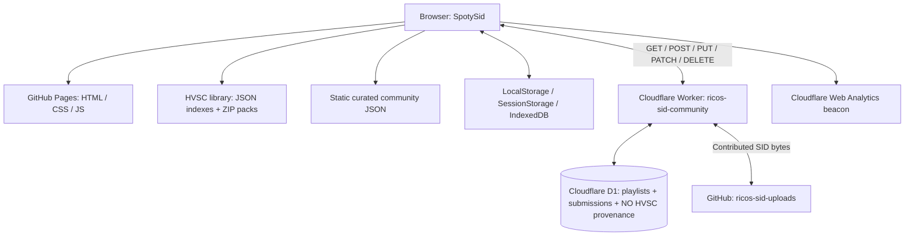

# SpotySid — Architecture and operational map

Updated: 2026-11-11 (Argentina). This is the **current** map; the former TEST62 architecture report remains a historical snapshot.

## Components



### Frontend / audio

- `index.html` loads `css/style.css`, `js/customPlaylist.test101.js`, `js/sidPlayer.js`, `js/backend_tinysid.js`, JSZip, HELP and DONATE.
- The `test101` filename is historical; it is currently loaded by `index.html`. Do not rename or replace without checking all references.
- The SID engine is separate from the community and playlist code. Avoid changing playback when working on catalog or UI.
- **Selective reSIDfp:** `lft-test/lft-mode.experimental.js` bridges the existing TinySID interface to `lft-test/lft-wasm/` for an explicit allowlist of LFT HVSC sources plus the **single** `Loco_un_Poco.sid` Uctumi source. The bridge from TEST188 was restored **byte-for-byte** in TEST193 and is the active bridge. The original `js/backend_tinysid.js` remains the default engine.
- **Audio status:** `Loco_un_Poco.sid` has a MOS8580-specific route, but the intro-to-rhythm/filter/volume behaviour remains unresolved. Do **not** label it PASS or extend this route to all Uctumi songs without isolated verification. Historical TEST189–192 changes are not active.
- **Uctumi audit only:** `library/uctumi-chip-profiles.json` documents the original 99 Uctumi PSID headers (97 PAL/8580; 2 PAL/6581, including two 2SID tunes); it is not a runtime switch for 99 songs.
- `library/index.json`, `library/data/` and `library/packs/` supply HVSC metadata and ZIP files. The documented HVSC #85 index contains 59,626 SID (56,568 MUSICIANS and 3,058 DEMOS).
- `library/groups/index.json` and `library/groups/groups-*.json` provide a **derived** CSDb/HVSC release-credit GROUPS browser (currently **84 group headings / 10,385 references**). The Codeblasters have **9 GROUPS references**; those indexes are separate from D1 published user playlists.
- `community/playlists.json` and `community/playlists/` contain curated static lists. Public user playlists are separate D1 records.
- `index.html` includes one Cloudflare Web Analytics beacon (TEST169); it has no impact on SID synthesis or community editing.
- Progressive first-track loading is used for selected large playlists, including RICO'S BEST OF MUS (user verified, TEST148).

### Data and publication

Public reference playlist v2:

```json
{
  "format": "ricos-sid-playlist",
  "version": 2,
  "name": "Example",
  "createdBy": "RICO",
  "tracks": [{"pack": "library/packs/musicians/U/Uctumi.zip", "file": "Balloon_Country_Bursts.sid"}]
}
```

Public v2 playlists can also contain `{sidId, file}` references to immutable contributed PSID/RSID binaries archived in **NO HVSC**. The NO HVSC collection has ID `00000000-0000-4000-8000-000000000001`. The current asset provider is GitHub (`serigrafiamdp-web/ricos-sid-uploads`); D1 holds references and metadata in `sid_assets`, `sid_collections`, `sid_collection_tracks` and `sid_provenance`, with `hvsc_status='unverified'` until separately researched. No contributed binary is embedded in a public v2 playlist. Older version-1 playlists may store embedded SID data and need continued backward compatibility.

### ADD + TO and REPUBLISH

1. The user selects a destination in the floating playlist **ADD + TO** dropdown. Display labels contain only playlist names. The selection is stored as `rico-add-to-destination` in localStorage and persists until changed explicitly.
2. Selecting a published list prepares or reuses a linked private draft without opening an editor or interrupting playback.
3. Pressing **+** adds a valid HVSC reference or an archived NO HVSC `sidId` reference to that draft; it does not immediately change D1.
4. The browser's local drafts retain their remote ID (`remoteEditId`), track references and original snapshot. Unpublished edits are not visible to other visitors.
5. **REPUBLISH** uses `PUT /playlists/:id`, not `POST /playlists`; it requires a beta key and the current server snapshot hash. The Worker applies its optimistic-concurrency check; client then reads back to verify persisted references.
6. The main playlist and COMMUNITY REPUBLISH controls must refer to the same linked draft. **TEST168 (NO HVSC → UCTUMI → REPUBLISH)** remains **pending end-to-end verification**, even though the archive API and import are confirmed.
7. Editing an existing playlist should never silently create a second public ID. Public entries with duplicate *names* must not be assumed to be the same identity: remote ID identifies a specific public record.

### Worker / D1

- Worker: `ricos-sid-community`, deployed separately from GitHub Pages.
- Source of reference: `community/api/worker.js`; schema: `community/api/schema.sql`; Wrangler configuration: `community/api/wrangler.toml`.
- Production D1 binding: `DB`. Beta authorization depends on server-side `BETA_EDIT_KEY` (never commit secrets).
- API: `GET /capabilities`, `GET /playlists`, `GET /playlists/:id`, `POST /playlists`, `PUT /playlists/:id`, `PATCH /playlists/:id`, `DELETE /playlists/:id`, `GET/POST /no-hvsc`, `GET /sid-assets/:sidId`, plus contributed collection routes.
- After the manual TEST165 FIX4 Worker deployment, `/capabilities` was observed advertising `noHvscArchive:true`, `sidUploadsEnabled:true`, `sidUploadProvider:'github'`, `sidUploadLimit:15`, `playlistTrackAdditions:true`, `playlistReorder:true`, `sidCollectionReorder:true` and `configured:true`. `/no-hvsc` returned a valid empty collection before the user-reported TEST167 import PASS. Capability flags do not confirm a particular playlist write.
- The Worker checks input formats and permissions; a mutation with an out-of-date source payload may return HTTP 409. Do not remove concurrency safety by bypassing the API.

### Operational boundaries

- GitHub repository: website source, manifests, HVSC library and Worker reference source.
- Cloudflare Worker deployment: independently versioned from GitHub; dashboard edits may differ from repository code.
- Cloudflare D1: live community data and submission records, **not backed up by GitHub**.
- Browser storage: local playlists, private edit drafts, chosen destination; local storage is not a cross-device backup.
- Cloudflare Web Analytics: installed for hostname `serigrafiamdp-web.github.io`. To isolate SpotySid, filter by `/RICOS-MOD-JAMES-SIDPLAYER-ONLINE/`. Web visit data starts only after beacon installation; Worker invocations are not visitor counts.
- Preserve public IDs, published data, existing bindings, secrets and service names during maintenance.
- Before deploying a new Worker: back up live Worker code + D1, compare current deployment with repository, deploy only intended changes, confirm `/capabilities`, test one authorized edit and verify after reload.
- Test labels and screenshots are diagnostic history. Do not label a fix PASS without user confirmation.

## Source and historical records

[README](../README.md) · **[Features](FEATURES.md)** · **[Checkpoint 2026-11-11](CHECKPOINT_2026-11-11_SPOTYSID.md)** · [Checkpoint 2026-11-10](CHECKPOINT_2026-11-10_SPOTYSID.md) · [NO HVSC TEST165](NO_HVSC_ARCHIVE_TEST165.md) · [User guide](HELP_USER_GUIDE.md) · [Historical TEST62 architecture](ARCHITECTURE_COMMUNITY_HVSC_D1_TEST62.md) · [TEST118 Worker/content-edit design](TEST118_EDIT_PUBLISHED_PLAYLIST_CONTENT.md)
